

  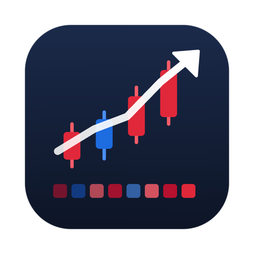

<h1 align="center">UpLog</h1>

  내 토스증권 계좌의 하루하루를 깃허브 잔디처럼 쌓아 보여 주는 맥 앱

  

Apple Silicon 맥 · macOS 14 이상 · 무료 · 서버 없음(키와 기록은 내 맥에만)

  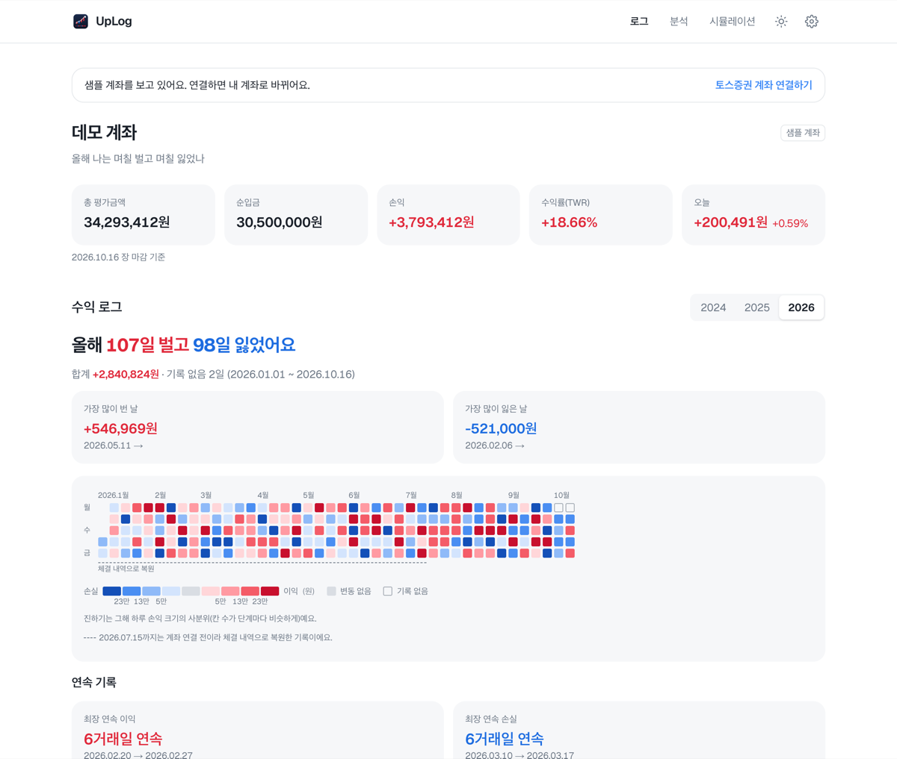

> 스크린샷은 연결 전 보이는 **데모 계좌**(합성 데이터)입니다.

## 화면과 기능

### 수익 로그
하루 손익을 칸 하나로 보여 줍니다. **이익은 빨강, 손실은 파랑**이고, 진할수록 크게 벌거나 잃은 날입니다.
"올해 며칠 벌고 며칠 잃었나", 가장 많이 번 날과 잃은 날, 최장 연속 이익·손실, 현재 보유 종목까지 한 화면에 모았습니다.

### 하루 기록 · 종목 상세

| 하루 기록 | 종목 상세 |
|---|---|
| 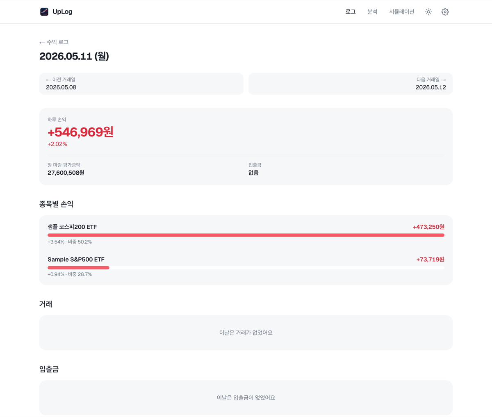 | 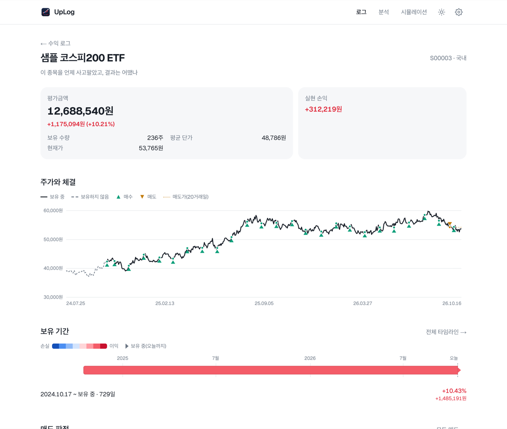 |
| 칸을 누르면 그날 손익과 종목별 기여, 거래, 입출금을 보여 줍니다. | 주가 위에 내 매수·매도 시점, 보유 기간, 실현 손익을 보여 줍니다. |

### 분석
내 계좌로 답할 수 있는 질문만 보여 줍니다(매도가 없으면 매도 분석은 숨깁니다).

| 그림자 계좌 | 손익 폭포수 |
|---|---|
| 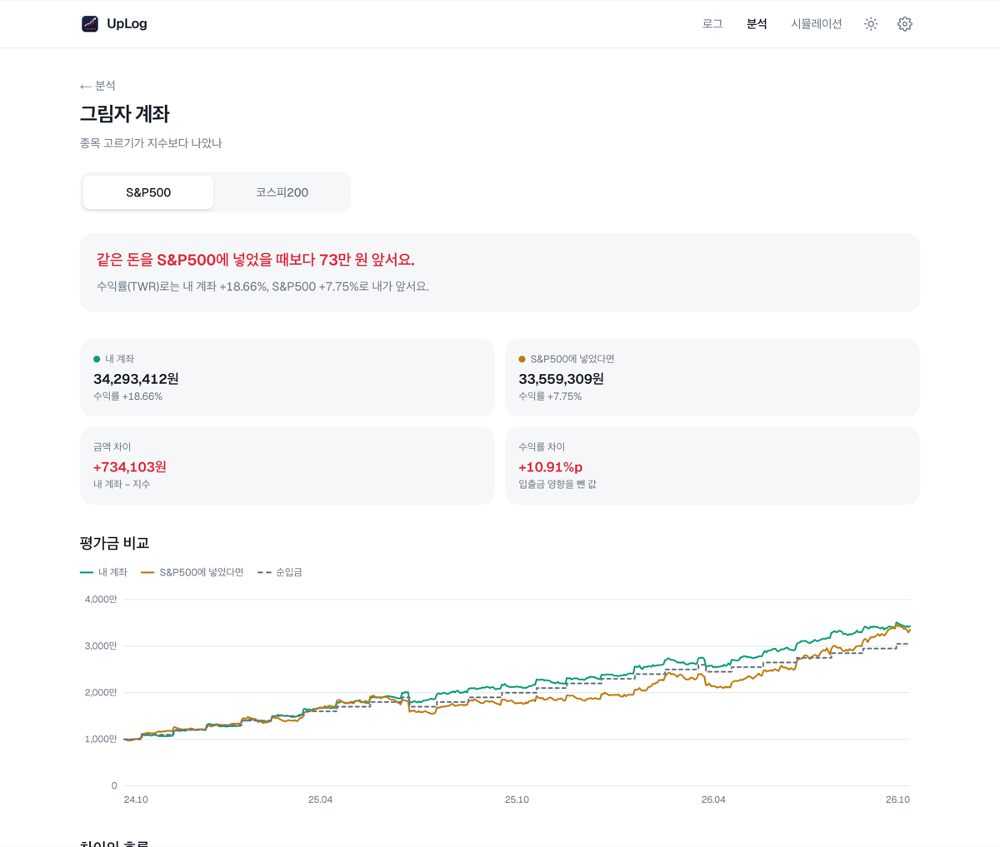 | 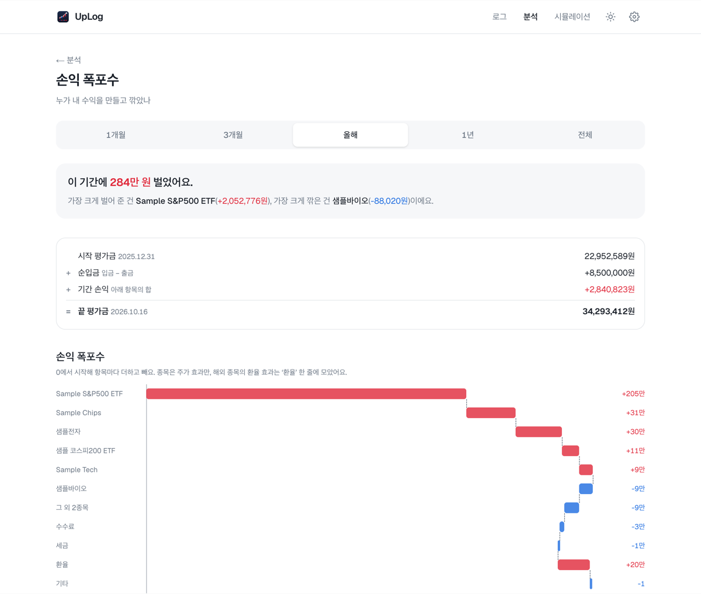 |
| 같은 돈을 S&P500·코스피200에 넣었다면? | 어떤 종목·수수료·세금·환율이 수익을 만들고 깎았나 |

| 월별 성적표 | 자산 구성 변화 |
|---|---|
| 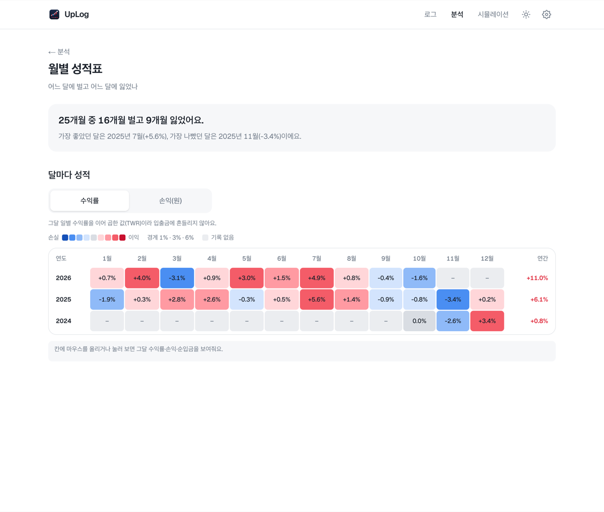 | 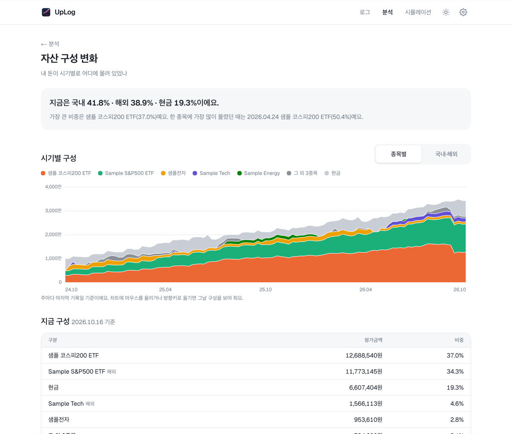 |
| 어느 달에 벌고 어느 달에 잃었나 | 내 돈이 시기별로 어디에 몰려 있었나 |

그 밖에 **판 뒤의 그림자**(판 종목이 그 뒤 어떻게 됐나), **보유 기간 타임라인**, **수익 분해**(종목 덕인지 환율 덕인지),
**수중 차트**(고점 대비 하락), **매매 습관**, **숨은 비용**이 있습니다.

### 시뮬레이션

| 조건 입력 | 결과 |
|---|---|
| 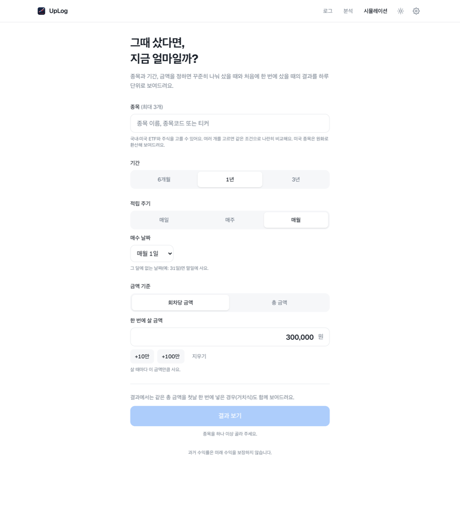 | 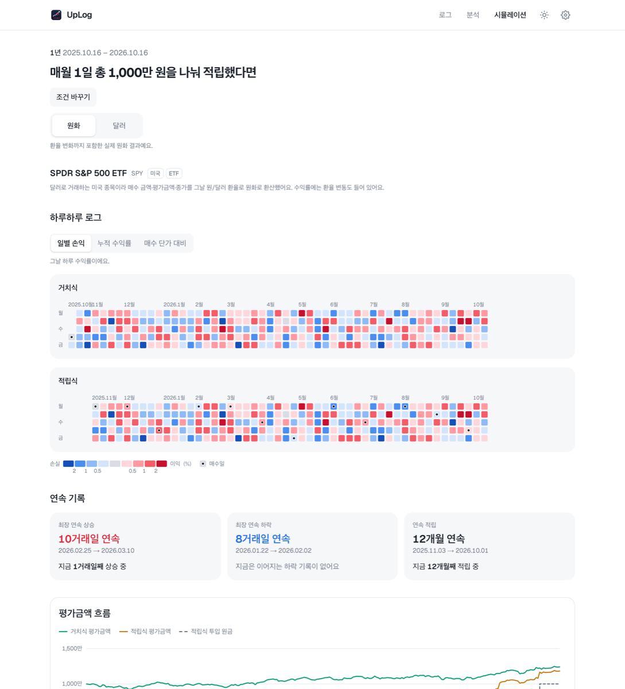 |
| 실제 종목·기간·적립 주기·금액을 고릅니다. | 한 번에 샀을 때와 나눠 샀을 때를 로그·연속 기록·평가금액으로 비교합니다. 원화/달러 기준을 바꿔 볼 수 있습니다. |

### 맥 위젯

| 중간 | 큰 크기 |
|---|---|
| 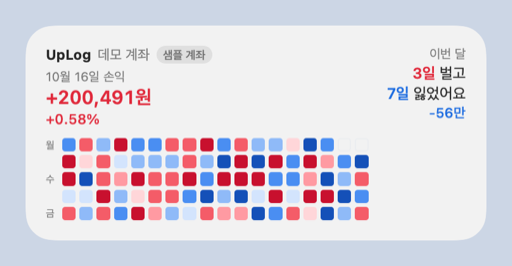 | 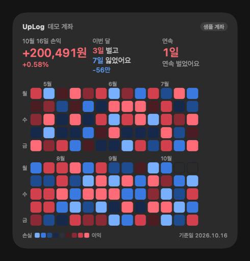 |

위젯 편집 → **UpLog** → "UpLog 로그"를 추가하면 바탕화면에서 오늘 손익과 로그를 바로 볼 수 있습니다(작은·중간·큰 크기).

### 계좌 연결
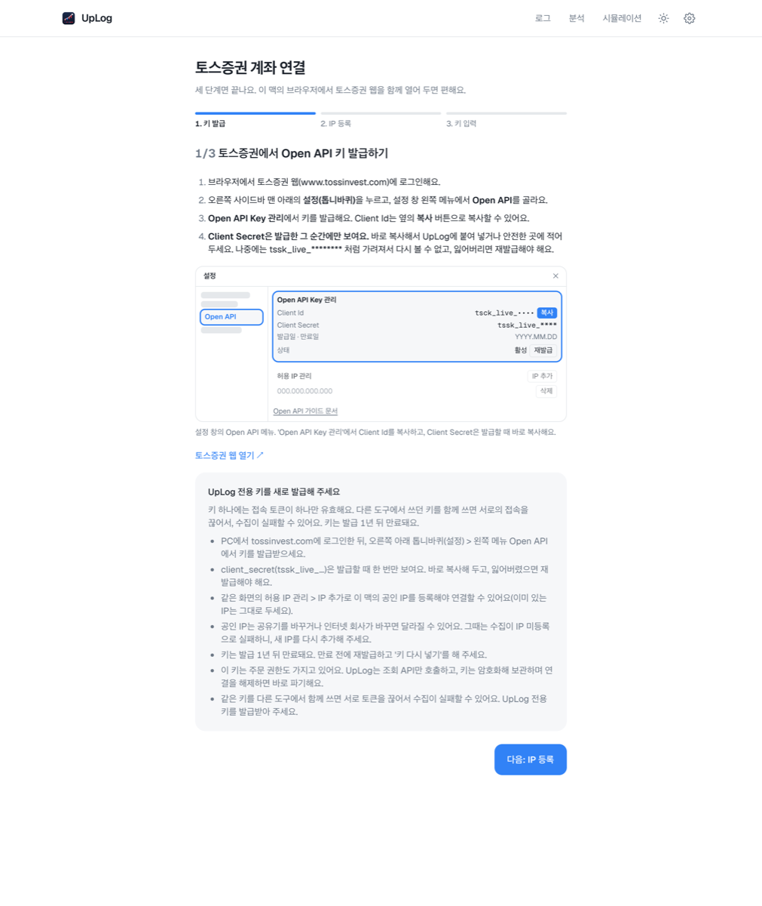

토스증권 웹에서 Open API 키를 발급하고, 이 맥의 공인 IP를 등록한 뒤, 키를 붙여 넣는 세 단계입니다.
UpLog는 **조회 API만** 쓰고, 키는 macOS 키체인으로 암호화해 이 맥에만 둡니다. 매일 아침 7시에 전 거래일 기록을 받아 옵니다.

## 설치

1. 위 **다운로드** 버튼으로 받은 `.dmg`를 열고 UpLog를 응용 프로그램 폴더로 끌어 놓습니다.
2. 아직 Apple 공증 전이라 처음 열 때 막히면, Finder에서 UpLog를 **오른쪽 클릭 → 열기**를 누르거나
   **시스템 설정 → 개인정보 보호 및 보안 → 그래도 열기**를 누릅니다.
   "손상되었기 때문에 열 수 없습니다"가 뜨면 터미널에서 `xattr -dr com.apple.quarantine /Applications/UpLog.app`을 실행합니다.
3. 창을 닫아도 메뉴바 아이콘으로 계속 돌며 매일 기록을 모읍니다. 완전히 끄려면 메뉴바의 "UpLog 종료" 또는 ⌘Q.

새 버전은 새 `.dmg`로 덮어 설치하면 되고 기록은 그대로 남습니다(`~/Library/Application Support/uplog`).

## 개발

빌드·실행·구조는 [docs/DEVELOPMENT.md](docs/DEVELOPMENT.md), 설계는 [docs/ARCHITECTURE.md](docs/ARCHITECTURE.md).
